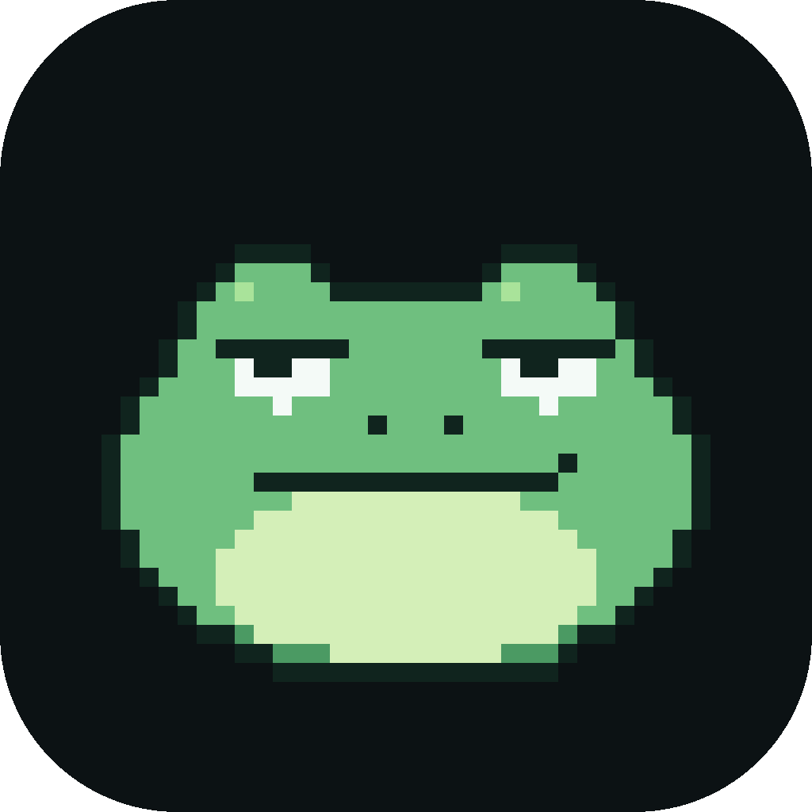
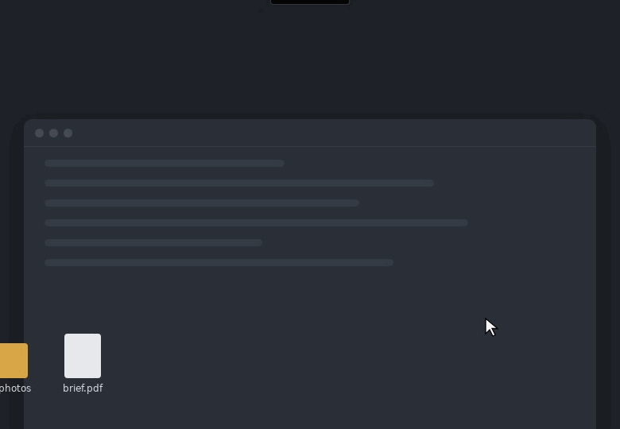
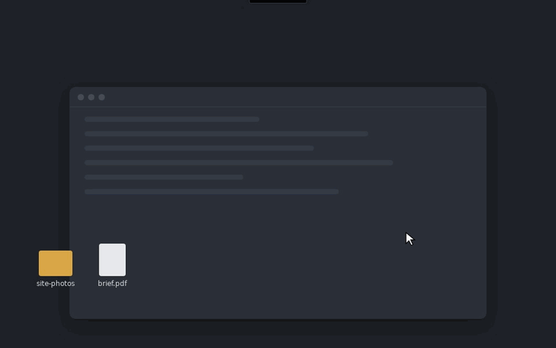

<p align="center">
  
</p>

<h1 align="center">Relay desktop</h1>

<p align="center">
  A small island at the top of your screen that shows what your Relay sessions are doing,<br />
  lets you reply to them, and takes the files you drop on it.
</p>

<p align="center">
  <a href="https://github.com/Lyvvy-xyz/relay-desktop/releases/tag/buddy-latest"><b>Download</b></a>
  &nbsp;·&nbsp;
  <a href="#build-from-source">Build from source</a>
  &nbsp;·&nbsp;
  <a href="#licence">Licence</a>
</p>

<p align="center">
  
</p>

## At the top of the screen

The island stays tucked away as a thin handle until you move the pointer to the top of the
screen, even mid-drag. While a session works, it shows the current step. When a session finishes
or needs you, it opens into a card you can act on without switching windows.

## Chat with your sessions

<p align="center">
  
</p>

Click the island and the panel drops down: sessions on the left, the conversation on the right.
Replies render as formatted text with code highlighting, and each step a session takes is listed as
it happens.

## Drop files on it

<p align="center">
  
</p>

Drag files or whole folders to the top of the screen and the frog takes them. Pick a session and
send. The session can save its changes straight back to the originals, and the previous version
of each file is kept.

## Also

- **Activity:** every file a project read or wrote on this computer, and every screenshot it took.
- **Show what's wrong:** draw a box around part of your screen and send it as a screenshot.
- **Claude Code:** talk to Claude Code running on this computer instead of Relay. Edits inside the
  project folder go ahead; anything else asks you first, in the island.
- **Updates itself:** each update is signed, and the app refuses one that isn't.

## Install

Download from the [latest release](https://github.com/Lyvvy-xyz/relay-desktop/releases/tag/buddy-latest):

| Computer | File |
| --- | --- |
| Windows | the `-setup.exe` |
| macOS, Apple silicon | the `aarch64` `.dmg` |
| macOS, Intel | the `x64` `.dmg` |
| Linux | the `.AppImage` or `.deb` |

On first launch, pair it with your Relay server using a code from the server's Machines page.

## Build from source

`buddy/` is the app (Tauri 2: Rust with a plain JavaScript interface). `agent/` is the background
agent it bundles (Go), which pairs the computer with a Relay server and moves files between them.

You need Go, Rust and Node.js 20.

```sh
cd agent
go build -o ../buddy/src-tauri/binaries/homelab-agent-$(rustc -vV | sed -n 's/host: //p') .
cd ../buddy
npm install
npx tauri icon app-icon.svg
npx tauri build
```

Tests: `go test ./...` in `agent/`, and `node --test buddy/ui/*.test.mjs`.

## Licence

Copyright © 2026 Lyvvy. GNU Affero General Public License v3.0 only, see [LICENSE](LICENSE).
For a licence without the AGPL's terms, open an issue asking for one.

Pull requests aren't accepted yet.

Bundled third-party files keep their own licences: highlight.js (BSD-3-Clause), and the Archivo and
DM Mono fonts (SIL Open Font License 1.1).
